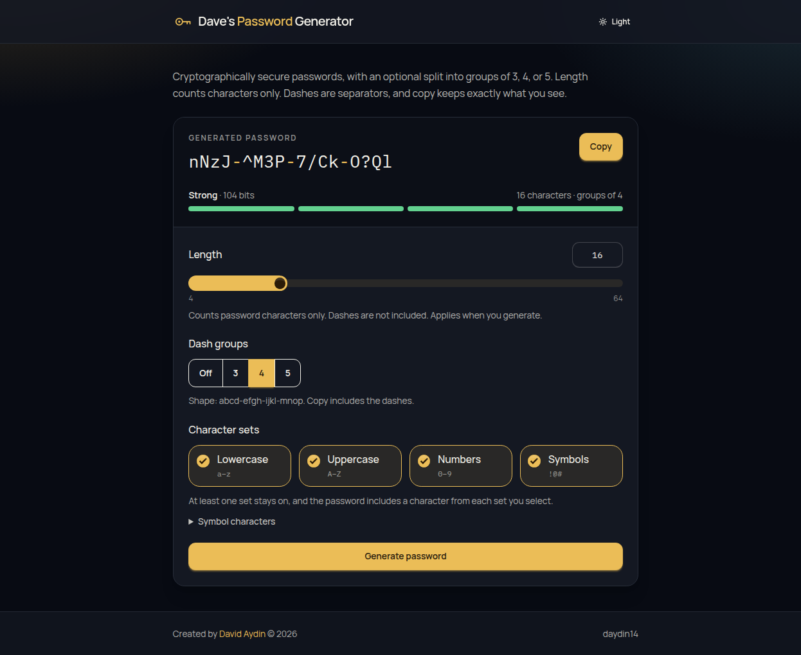
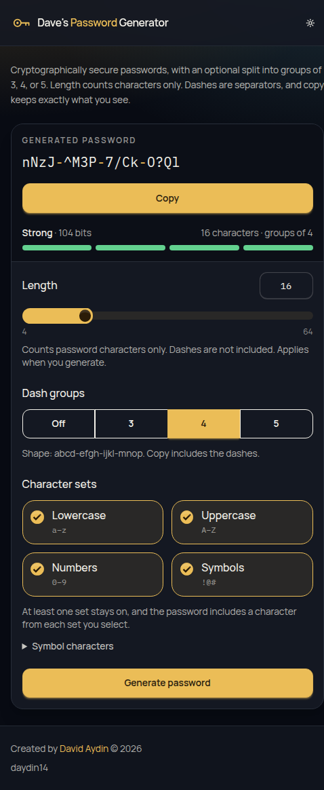

# Dave's Password Generator

Generate a cryptographically secure password, then split it into groups you can read and type back.

[daydin14.github.io/password-generator](https://daydin14.github.io/password-generator/)

## Screenshots





## Features

- Passwords come from `crypto.getRandomValues`. Indexes are chosen with rejection sampling, so the result is not biased by a modulo remainder.
- Every selected character set contributes at least one character. The rest of the password is drawn from the combined set, then shuffled.
- Length is 4–64. Lowercase, uppercase, numbers, and symbols can be mixed. At least one set stays on.
- Optional dash groups of 3, 4, or 5. A short final group is kept when the length does not divide evenly.
- Strength meter based on the entropy of the current password.
- Copy puts the password on the clipboard exactly as it is shown, and the button confirms it.
- Light and dark themes. The first visit follows the system preference; the toggle remembers your choice.
- Controls are labeled, the strength meter exposes its value, and the layout works on a phone and a desktop.

## Length and dashes

**The length is the number of password characters. Dashes are not counted.**

Grouping only inserts `-` between groups. A length of 12 with groups of 4 is displayed as `abcd-efgh-ijkl`: 12 characters and 2 separators. Groups of 3 and 5 work the same way, and the last group is shorter when the length is not a multiple (a length of 10 with groups of 3 is `xxx-xxx-xxx-x`).

Copy copies that displayed text, dashes included. The hyphen is not part of the symbol set, so a dash on screen is always a group boundary.

Changing the group size reformats the current password immediately. Length and character sets apply the next time you generate.

## Setup

Requires Node.js 20 or newer.

```bash
cd app
npm install
npm run dev
```

Open [http://localhost:5173/password-generator/](http://localhost:5173/password-generator/). The dev server redirects `/` to that path so it matches the GitHub Pages project URL.

## Scripts

| Script | What it does |
| --- | --- |
| `npm run dev` | Start the Vite dev server |
| `npm run build` | Typecheck and build `dist/` |
| `npm run preview` | Serve the production build |
| `npm run lint` | Run ESLint |
| `npm test` | Run Vitest |

## GitHub Pages

[`.github/workflows/pages.yml`](.github/workflows/pages.yml) builds `app/` with Vite and publishes `app/dist` on every push to `master`. The Vite `base` is `/password-generator/`.

Pull requests run lint, tests, and the production build in [`.github/workflows/ci.yml`](.github/workflows/ci.yml).

One setting has to be changed before that workflow can replace the current site. Pages is still on the legacy `gh-pages` branch (`build_type: legacy`). In the repository:

1. Open **Settings → Pages**.
2. Under **Build and deployment**, set **Source** to **GitHub Actions**.

After that, a push to `master` deploys the Vite build. The published URL stays [https://daydin14.github.io/password-generator/](https://daydin14.github.io/password-generator/).

## Project layout

```
app/
├── index.html
├── vite.config.ts          base path /password-generator/
├── src/lib/password.ts     generator, grouping, and strength
├── src/components/Generator.tsx
└── src/App.tsx             theme, header, and footer
.github/workflows/pages.yml
.github/workflows/ci.yml
```

React 19, Vite, TypeScript, Tailwind CSS 4, and daisyUI 5.
